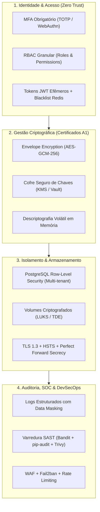
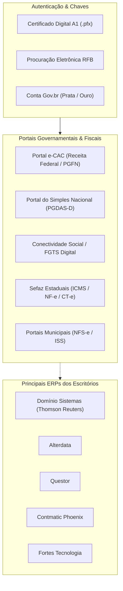
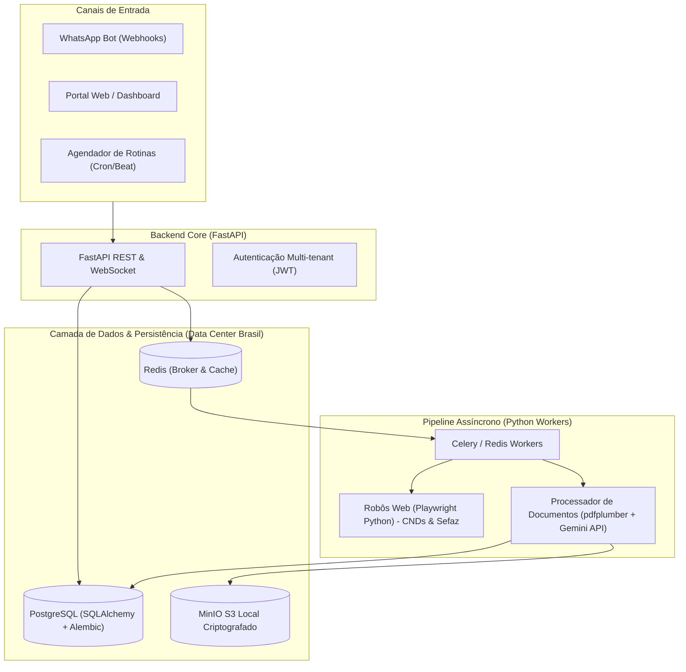
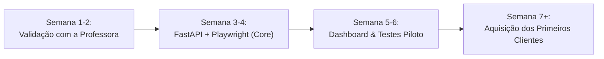

# Playbook: Construção e Escala de SaaS para Escritórios Contábeis (Ecossistema Python & Security-by-Design)

Este playbook serve como guia estratégico, técnico e operacional para transformar as rotinas de escritórios de contabilidade em um produto SaaS escalável e de alto valor, priorizando o ecossistema **Python**, soberania de dados com **infraestrutura nacional e LGPD**, e uma arquitetura rigorosa de **Segurança da Informação e DevSecOps** baseada nos padrões **ISO 27001, NIST e OWASP**.

---

## 1. Visão Geral e Proposta de Valor

### O Cenário do Setor Contábil
Os escritórios contábeis no Brasil lidam com margens comprimidas devido a três gargalos operacionais:
1. **Dependência e atrito com o cliente final:** Atraso crônico no envio de notas, extratos e comprovantes.
2. **Trabalho braçal repetitivo:** Digitação manual de lançamentos, consulta recorrente de CNDs e emissão de guias tributárias.
3. **Comunicação descentralizada:** Solicitações perdidas em canais informais (WhatsApp pessoal, múltiplos e-mails), gerando retrabalho e risco de multas.

### Proposta de Valor
> **"Automatizar até 70% das rotinas operacionais e de conformidade fiscal através de robôs autônomos e IA em Python, garantindo nível bancário de segurança da informação (ISO 27001 / OWASP), dados 100% hospedados no Brasil e total aderência à LGPD."**

---

## 2. Framework de Segurança da Informação (Security-by-Design)

Como escritórios contábeis custodiam os dados mais críticos das empresas (balanços, faturamento, certidões, senhas e folhas de pagamento com CPFs e salários), o produto é projetado desde o dia zero sob a filosofia de **Segurança por Padrão (Security-by-Design)**.

### 2.1 Gestão Criptográfica dos Certificados Digitais A1 (.pfx)
O certificado digital A1 confere poderes jurídicos totais perante o Fisco. Portanto, seu armazenamento adota **Criptografia em Envelope (Envelope Encryption)**:
* **AES-GCM de 256 bits:** Cada arquivo de certificado é criptografado com uma chave de dados exclusiva (*Data Encryption Key - DEK*).
* **Key Encryption Key (KEK):** As DEKs são cifradas por uma chave mestra separada, armazenada em variáveis de ambiente seguras ou cofre (*HashiCorp Vault*).
* **Uso estritamente volátil:** O certificado e sua senha nunca são gravados decifrados em disco. O worker Python carrega o certificado diretamente em memória RAM apenas durante a execução do robô Playwright/HTTP e o desaloca imediatamente após o término da requisição.

### 2.2 Isolamento de Dados Multi-tenant com PostgreSQL RLS
* **Row-Level Security (RLS) nativo:** Mesmo que ocorra qualquer falha lógica na aplicação (ex: falha de validação ou SQL Injection), o banco de dados PostgreSQL bloqueia categoricamente qualquer consulta cujas linhas pertençam a outro `tenant_id` (escritório contábil).
* **Bancos de dados segregados logicamente:** Cada query injeta o contexto da sessão do escritório autenticado via variáveis de ambiente da conexão (`SET LOCAL app.current_tenant_id`).

### 2.3 Gestão de Identidade, Acesso e Autenticação (IAM)
* **Autenticação Multifator (MFA/2FA):** Obrigatória para todos os operadores do escritório contábil (via TOTP no Google Authenticator / Microsoft Authenticator).
* **Controle de Acesso Baseado em Função (RBAC):**
  * *Administrador do Escritório:* Gestão de equipe, faturamento e exclusão de dados.
  * *Analista Fiscal / DP / Contábil:* Acesso operacional restrito aos clientes atribuídos a ele.
  * *Cliente Final (Portal Web):* Visão exclusiva da sua própria empresa, sem permissão de alteração de configurações.
* **Políticas de Senha:** Hashing via `argon2-cffi` (resistente a ataques de GPU/ASIC), com comprimento mínimo de 12 caracteres e verificação contra bases de senhas vazadas (*Have I Been Pwned*).

### 2.4 Trilha de Auditoria Imutável e Proteção de Logs (SIEM Ready)
* **Data Masking (Anonimização de Logs):** Nenhum dado pessoal sensível (CPF completo, senha, token JWT, dados bancários) é registrado em logs de texto.
* **Logs de Eventos Críticos:** Toda ação sensível (download de CND, visualização de folha de pagamento, envio de declaração, login) gera um evento com carimbo de tempo UTC, ID do usuário, endereço IP de origem e hash do documento.
* **Retenção e Descarte Seguro:** Logs armazenados com política WORM (*Write Once, Read Many*) e expiração configurada conforme os prazos legais da LGPD e do Código Tributário Nacional.

### 2.5 DevSecOps e Segurança de Infraestrutura
* **Containers não-root:** Todos os containers Docker (FastAPI, Celery, Playwright) rodam sob usuários Linux sem privilégios administrativos.
* **Análise Estática de Segurança (SAST):** Pipeline com `bandit` (segurança de código Python) e `pip-audit` / `Trivy` (verificação de vulnerabilidades conhecidas - CVEs - em bibliotecas e imagens base).
* **Defesa de Perímetro:** Firewall restritivo (UFW), `fail2ban` ativo para contenção de ataques de força bruta em SSH/APIs, e rate limiting estrito por IP nas rotas de autenticação.
* **Política de Backup 3-2-1:** 3 cópias dos dados, em 2 mídias diferentes, sendo 1 externa criptografada, com teste automático quinzenal de restauração (*Disaster Recovery Plan*).

---

## 3. Mapa do Ecossistema Externo (Governo, ERPs e Acessos)

### 3.1 Portais Oficiais & Mecanismos de Acesso
* **Portal e-CAC (Receita Federal / PGFN):** Situação fiscal, caixas postais, DCTFWeb, e-Social e parcelamentos.
* **Simples Nacional:** PGDAS-D e guias DAS.
* **FGTS Digital & Conectividade Social:** Emissão do CRF (Certidão do FGTS).
* **Certificado Digital A1 (.pfx / .p12):** Obrigatório para automações em nuvem (ao contrário do A3, não requer token USB físico).
* **Procuração Eletrônica:** Permite que o escritório atenda centenas de empresas usando **apenas o certificado digital do próprio escritório**.

---

## 4. Matriz de Dores x Módulos do SaaS

| Área | Dor Operacional | Solução SaaS (Feature) | Impacto no Escritório |
| :--- | :--- | :--- | :--- |
| **Atendimento / Coleta** | Clientes esquecem de enviar documentos ou mandam fotos ilegíveis | Coletor inteligente via WhatsApp + Portal Web com checklist automático de pendências | Elimina o "caos do dia 5 ao dia 10" de cada mês |
| **Contábil / Financeiro** | Conciliação bancária manual e digitação de extratos e comprovantes | Pipeline Python de OCR + IA para extração e classificação de extratos (OFX/PDF) e recibos | Redução drástica de digitação e retrabalho |
| **Fiscal / Tributário** | Falta de notas fiscais do mês e risco de multas fiscais | Robôs de captura automática de XMLs (Sefaz/Prefeituras) e envio programado de guias (DAS/DARF) | Cumprimento rigoroso de prazos e conformidade |
| **Conformidade (Legal)** | Certidões Negativas (CNDs) vencendo sem aviso prévio | Worker autônomo em Python que consulta periodicamente Receita/PGFN, FGTS, Estados e Municípios | Monitoramento preventivo 24/7 e alto valor percebido |
| **DP / RH** | Coleta manual de documentos de admissão e envio avulso de holerites | Formulário de admissão digital com validação e distribuição automática de contracheques por canal seguro | Padronização e zero extravio de dados sensíveis |

---

## 5. Arquitetura da Solução em Python

### Tecnologias-Chave:
* **Backend:** `FastAPI` + `Pydantic v2` + `SQLAlchemy 2.0` (Async) + `Alembic`.
* **Workers & Filas:** `Celery` + `Redis` + `Celery Beat`.
* **Robôs RPA:** `Playwright for Python` (headless chromium) + `httpx`.
* **IA & OCR:** `Google Gemini API` (multimodal) + `pdfplumber` / `PyMuPDF`.

---

## 6. Provedores Nacionais de VPS e Custos de Infraestrutura

Com data centers em São Paulo e faturamento nacional em reais:

### 6.1 Opções de Provedores com Servidores no Brasil (São Paulo)

| Provedor | Especificações | Custo Mensal (BRL) | Vantagens para o Projeto |
| :--- | :--- | :--- | :--- |
| **Hostinger Brasil (Data Center SP)** *(Recomendado para início)* | 2 vCPU / 8 GB RAM / 100 GB NVMe | **R$ 49,00 a R$ 69,00 / mês** | Servidores em São Paulo, cobrança em R$ (sem IOF), suporte em português e excelente quantidade de RAM. |
| **Locaweb Cloud Server Pro** | 2 vCPU / 4 GB RAM / 80 GB SSD | ~ R$ 130,00 / mês | 100% brasileira, consolidada no setor corporativo. |
| **UOL Host / Compass UOL** | 2 vCPU / 4 GB RAM / 60 GB SSD | ~ R$ 119,00 / mês | Data center nacional, baixa latência com órgãos do governo. |
| **AWS Brasil (Região sa-east-1 SP)** | Instância t4g.medium (2 vCPU / 4 GB RAM) | ~ R$ 220,00 a R$ 300,00 / mês | Alta escalabilidade, porém custo mais elevado para o MVP. |

---

### 6.2 Estimativa Total de Custos para o MVP (Foco Nacional)

* **VPS Hostinger Brasil (Data Center São Paulo - 8 GB RAM):** ~ R$ 59,00 / mês
* **Domínio próprio (.com.br no Registro.br):** R$ 40,00 / ano (~ R$ 3,33 / mês)
* **Armazenamento de Arquivos Local (MinIO Criptografado na própria VPS):** R$ 0,00
* **IA / OCR (Gemini Flash para leitura de comprovantes):** ~ R$ 5,00 / mês (gratuito ou centavos por lote)
* **WhatsApp (Evolution API instalada na própria VPS + Chip pré-pago dedicado):** ~ R$ 30,00 / mês
* **Total Mensal no MVP:** **~ R$ 95,00 a R$ 110,00 / mês** (Pago em reais, com nota fiscal nacional)

---

## 7. Estratégia de MVP Recomendado

> [!TIP]
> **MVP sugerido:** Monitor Inteligente de CNDs e Pendências (Receita Federal + FGTS Caixa).
> - Baixo consumo de máquina e custo operacional inicial inferior a R$ 110/mês.
> - Nenhum risco de mexer no banco contábil do cliente.
> - O escritório da professora já pode usar na primeira semana para gerar valor imediato.

---

## 8. Modelo de Negócio e Precificação (Pricing)

| Plano | Faixa de Empresas | Preço Sugerido (Mensal) | Perfil do Assinante |
| :--- | :--- | :--- | :--- |
| **Starter** | Até 30 CNPJs | R$ 197 / mês | Contadores autônomos ou carteira inicial |
| **Pro** | Até 100 CNPJs | R$ 497 / mês | Escritórios de pequeno/médio porte (perfil mais comum) |
| **Scale** | Até 250 CNPJs | R$ 897 / mês | Escritórios consolidados com equipe dividida em setores |
| **Enterprise** | Acima de 250 CNPJs | Sob consulta (R$ 3 a R$ 5 por CNPJ adicional) | Grandes escritórios ou franquias contábeis |

---

## 9. Roteiro de Implementação Passo a Passo

1. **Validação (Semanas 1 e 2):**
   * Mapear com a professora os sistemas do escritório e revisar as premissas de segurança e governança de dados.
   * Validar se a dor prioritária é a emissão de CNDs ou a cobrança de documentos via WhatsApp.
2. **Desenvolvimento do Core (Semanas 3 e 4):**
   * Configurar VPS nacional com Docker Compose (FastAPI + PostgreSQL com RLS + Redis + Celery).
   * Implementar criptografia de envelope para os certificados A1 e scripts em Playwright Python.
3. **Ambiente Piloto (Semanas 5 e 6):**
   * Cadastrar 20 a 30 clientes reais do escritório da professora para rodar o sistema em produção controlada (Beta fechado).
4. **Expansão Comercial (Semana 7 em diante):**
   * Apresentar o estudo de caso real de conformidade e horas economizadas para outros escritórios contábeis.
